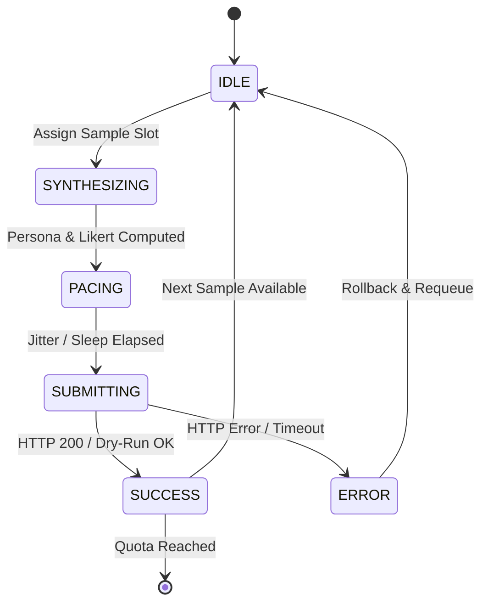

# Shopee Smart Locker TAM & TPB Survey Automation & Telemetry Monitor

[](https://www.python.org/)
[](https://streamlit.io/)
[](#psychometric-modeling--latent-traits)
[](#testing--adversarial-hardening)
[](#testing--adversarial-hardening)
[](#streamlit-dashboard--telemetry-ui)
[](LICENSE)

An enterprise-grade, high-concurrency synthetic survey automation and telemetry platform built for academic empirical research. Specifically engineered to model Vietnamese Gen Z consumer adoption of **Shopee Smart Locker** delivery systems through the joint lens of the **Technology Acceptance Model (TAM)** and the **Theory of Planned Behavior (TPB)** on Tally Form `laqVzV`.

The system synthesizes demographically cross-consistent respondent profiles (18–27 years old, major metropolitan hubs), models 11 correlated latent constructs across 38 Likert items guaranteeing scientific reliability ($\text{Cronbach's }\alpha \ge 0.82$), executes submissions across a 1–20 multithreaded worker fleet with humanized pacing, and exports pure numeric matrices ready for immediate structural equation modeling in **IBM SPSS Statistics**, **SmartPLS 3/4**, and **AMOS**.

---

## Table of Contents

1. [Overview & Key Features](#overview--key-features)
2. [Tech Stack](#tech-stack)
3. [Prerequisites](#prerequisites)
4. [Getting Started](#getting-started)
   - [1. Clone the Repository](#1-clone-the-repository)
   - [2. Create Virtual Environment](#2-create-virtual-environment)
   - [3. Install Dependencies](#3-install-dependencies)
   - [4. Verify Schema & Test Suite](#4-verify-schema--test-suite)
   - [5. Launch Web Dashboard](#5-launch-web-dashboard)
   - [6. Fast Dry-Run Walkthrough](#6-fast-dry-run-walkthrough)
5. [System Architecture & Theoretical Framework](#system-architecture--theoretical-framework)
   - [Layered Architecture](#layered-architecture)
   - [Theoretical Foundations: TAM & TPB Synthesis](#theoretical-foundations-tam--tpb-synthesis)
   - [11 Latent Constructs & Scale Specifications](#11-latent-constructs--scale-specifications)
   - [Demographic Profiling & 6 Cross-Consistency Rules](#demographic-profiling--6-cross-consistency-rules)
   - [Psychometric Engine & Cronbach's Alpha Formulation](#psychometric-engine--cronbachs-alpha-formulation)
6. [Streamlit Dashboard & Telemetry UI](#streamlit-dashboard--telemetry-ui)
   - [UI/UX Pro Max Principles & Swiss Slate Theme](#uiux-pro-max-principles--swiss-slate-theme)
   - [5 Top-Level KPI Metric Cards](#5-top-level-kpi-metric-cards)
   - [4-Tab Application Workspace](#4-tab-application-workspace)
   - [Interactive Plotly Visualizations](#interactive-plotly-visualizations)
7. [Worker Fleet, Pacing & Anti-Bot Scheduling](#worker-fleet-pacing--anti-bot-scheduling)
   - [6-State Finite State Machine (FSM)](#6-state-finite-state-machine-fsm)
   - [Ticket Reservation & Quota Concurrency Safety](#ticket-reservation--quota-concurrency-safety)
   - [Dual-Distribution Jitter Engine](#dual-distribution-jitter-engine)
   - [Diurnal Windows & Micro-Breaks](#diurnal-windows--micro-breaks)
8. [Data Export: SPSS & Excel Codebook](#data-export-spss--excel-codebook)
   - [Pure Numeric CSV Matrix (SPSS / SmartPLS)](#pure-numeric-csv-matrix-spss--smartpls)
   - [Reverse-Coded Variable Handling ($PC_{\text{rev}}$)](#reverse-coded-variable-handling-pc_textrev)
   - [3-Sheet Styled Excel Workbook](#3-sheet-styled-excel-workbook)
9. [Configuration & Session Persistence](#configuration--session-persistence)
   - [Session Configuration JSON Structure](#session-configuration-json-structure)
   - [Parameter Reference & Tuning Boundaries](#parameter-reference--tuning-boundaries)
10. [Available Scripts & CLI Commands](#available-scripts--cli-commands)
11. [Testing & Adversarial Hardening](#testing--adversarial-hardening)
    - [5-Tier Test Architecture](#5-tier-test-architecture)
    - [Unified Test Runner Usage](#unified-test-runner-usage)
    - [Test Suite Breakdown & Metrics](#test-suite-breakdown--metrics)
12. [Production Deployment](#production-deployment)
    - [VS Code Dev Containers](#vs-code-dev-containers)
    - [Docker Container Deployment](#docker-container-deployment)
    - [Linux VPS (Systemd & Nginx Reverse Proxy)](#linux-vps-systemd--nginx-reverse-proxy)
    - [Streamlit Community Cloud](#streamlit-community-cloud)
13. [Troubleshooting & FAQ](#troubleshooting--faq)
14. [Contributing Guidelines](#contributing-guidelines)
15. [License & Citation](#license--citation)

---

## Overview & Key Features

Collecting empirical survey responses for academic Structural Equation Modeling (SEM) is plagued by poor data quality, unengaged respondents, survey drop-offs at screening gates, and insufficient internal consistency ($\alpha < 0.70$).

This platform provides an automated, scientifically reproducible, and mathematically grounded survey execution engine. It generates high-fidelity respondent personas based on real Vietnamese Gen Z demographic distributions and behavioral parameters, evaluates TAM & TPB structural indicators, dynamically calculates streaming psychometric statistics, and submits payloads to Tally forms using naturalistic network pacing.

```
┌─────────────────────────────────────────────────────────────────────────────┐
│                          HIGH-LEVEL WORKFLOW                                │
└─────────────────────────────────────────────────────────────────────────────┘
  Persona Engine               Worker Fleet                   Tally Server
  ┌──────────────┐           ┌──────────────┐              ┌───────────────┐
  │ Demographic  │ ───────►  │ 1-20 Threads │ ──────────►  │ api.tally.so  │
  │ Synthesis &  │           │ Jitter & FSM │ (HTTP / Mock)│ Form: laqVzV  │
  │ Latent Trait │           │ Orchestrator │              └───────┬───────┘
  └──────────────┘           └──────┬───────┘                      │
                                    │ Telemetry Snapshot           │
                                    ▼                              ▼
                             ┌──────────────┐              ┌───────────────┐
                             │  Streamlit   │ ◄─────────── │ Streaming E2E │
                             │  Dashboard   │  Validation  │ Welford Covar │
                             │ 8 Live Plots │              │  α ≥ 0.820    │
                             └──────┬───────┘              └───────────────┘
                                    │
                                    ▼
                             ┌───────────────────────────────┐
                             │ Export: Pure Numeric SPSS CSV │
                             │ & 3-Sheet Excel Codebook .XLSX│
                             └───────────────────────────────┘
```

### Core Features

- **Canonical 51-Question & 287-Option Schema**: Programmatic mapping of Tally form `laqVzV` with exact group UUIDs, choice option UUIDs, and payload serialization schemas matching browser network traces.
- **Anti-Disqualification Screening Guard**: Enforces voluntary consent (Q1) and verified Shopee usage frequency within the qualifying window (Q2), eliminating drop-offs at early screening checkpoints.
- **Multi-Construct TAM & TPB Latent Trait Model**: Generates 38 Likert items (1–6 scale) across 11 constructs: Perceived Usefulness (PU), Ease of Use (PEOU), Economic Savings (PES), Complexity (PC), Innovativeness (PI), Self-Efficacy (SE), Location Convenience (LC), Attitude (ATT), Subjective Norms (SN), Perceived Behavioral Control (PBC), and Intention to Use (ITU).
- **Guaranteed Academic Reliability ($\text{Cronbach's }\alpha \ge 0.82$)**: Latent factor synthesis engine with tuned factor loadings ($0.86 - 0.89$) and controlled item noise ($\sigma \le 0.22$), ensuring all scales pass scientific publication thresholds.
- **Automated Reverse Coding for Negative Scales**: Automatically computes and preserves raw and inverted scores for Perceived Complexity ($PC_{\text{rev}} = 7 - PC_{\text{raw}}$), ensuring positive construct alignment in SEM models.
- **Real-Time Streaming Psychometrics (Welford Online Covariance)**: $O(1)$ memory and $O(K^2)$ vector online algorithm computing running construct means, standard deviations, item-total correlations (CITC), alpha-if-item-deleted, and overall Cronbach's alpha without storing redundant historical matrices.
- **1–20 Multithreaded Worker Fleet with 6-State FSM**: Thread-isolated persona generators managed by a central fleet coordinator with atomic snapshot publication and exact quota ticket reservation (`_reserve_submission_slot`), preventing race-condition overshoots.
- **Humanized Anti-Spam Pacing (Dual Jitter Engine)**: Truncated Gaussian $\mathcal{N}(\mu, \sigma^2)$ and Uniform $\mathcal{U}[t_{\min}, t_{\max}]$ random delay generators, coupled with periodic micro-breaks and interruptible sleep.
- **Diurnal Time-Window Scheduling**: Restricts execution to realistic daytime operational hours (e.g., `08:00-11:30, 13:30-22:00`), supporting batch size limits and cooldown periods.
- **Zero-Network Dry-Run Simulator**: Safe, offline simulation generating mock respondent payloads (`mock-dryrun-<uuid>`) with full pre-flight schema validation, enabling UI, analytics, and export testing without sending network requests to Tally.
- **Pure Numeric SPSS & 3-Sheet Excel Exporter**: Direct one-click download of pure numeric CSV files (with integer-encoded demographics and dummy variables) and multi-sheet styled Excel workbooks containing Data Matrix, Variable Codebook, and Reliability Summaries.
- **100% Tested with 5-Tier Hardening Suite**: 19 automated test suites comprising 324 test cases and 238,054 assertions covering feature contracts, boundaries, cross-feature interactions, scaled simulations, and adversarial race fuzzing.

---

## Tech Stack

| Layer | Technology | Version | Purpose |
| :--- | :--- | :--- | :--- |
| **Language & Runtime** | [Python](https://www.python.org/) | `3.11+` / `3.13` | Core execution environment |
| **Web Application & UI** | [Streamlit](https://streamlit.io/) | `>= 1.35.0, <= 1.55.0` | Swiss Slate telemetry dashboard, fragments, widgets |
| **HTTP Engine** | [HTTPX](https://www.encode.io/httpx/) | `>= 0.27.0` | HTTP/1.1 & HTTP/2 client with connection pooling |
| **Schema Validation** | [Pydantic](https://docs.pydantic.dev/) | `>= 2.7.0` | Question definitions, options, payload contracts |
| **Vector Math & Arrays** | [NumPy](https://numpy.org/) | `>= 1.24.0` | Latent factor generation, covariance matrix algebra |
| **Data Manipulation** | [Pandas](https://pandas.pydata.org/) | `>= 2.0.0` | Tabular data matrices, SPSS column encoding |
| **Statistical Analysis** | [SciPy](https://scipy.org/) | `>= 1.11.0` | Normal distributions, variance and covariance math |
| **Data Visualization** | [Plotly](https://plotly.com/python/) | `>= 5.20.0` | Interactive radar, gauges, 95% CI error bar charts |
| **Report Generation** | [XlsxWriter](https://xlsxwriter.readthedocs.io/) | `>= 3.1.0` | Styled 3-sheet Excel workbook export |
| **Containerization** | [Docker / DevContainer](https://containers.dev/) | `Bookworm 3.11` | Cross-platform containerized development & deploy |

---

## Prerequisites

Before setting up the project, ensure your workstation satisfies the following requirements:

- **Operating System**: Linux (Ubuntu 20.04+, Debian 11+), macOS (12+), or Windows 10/11 (PowerShell or WSL2).
- **Python Runtime**: Python `3.11.x`, `3.12.x`, or `3.13.x` (Python 3.13.5 recommended). Verify with:
  ```bash
  python --version
  ```
- **Package Manager**: `pip` (bundled with Python) and `venv` virtual environment module.
- **Git**: Version control client (`git >= 2.30`).
- **Network Access**: Outbound HTTPS connectivity to `api.tally.so:443` (only required when running in live mode; offline Dry-Run mode requires no internet connection).

---

## Getting Started

Follow these step-by-step instructions to get the application running locally on a clean machine.

### 1. Clone the Repository

```bash
git clone https://github.com/stknguyn/Autofill-Form.git
cd Autofill-Form
```

### 2. Create Virtual Environment

Isolate application dependencies using Python's standard `venv`:

**On Linux / macOS:**
```bash
python3 -m venv .venv
source .venv/bin/activate
```

**On Windows (PowerShell):**
```powershell
python -m venv .venv
.venv\Scripts\Activate.ps1
```

*(If script execution is disabled on Windows PowerShell, run: `Set-ExecutionPolicy -Scope Process -ExecutionPolicy Bypass`)*

### 3. Install Dependencies

Install pinned production dependencies:

```bash
pip install --upgrade pip
pip install -r requirements.txt
```

Verify installed packages:

```bash
pip list
```

### 4. Verify Schema & Test Suite

Run the fast unit verification suite to confirm that the environment, 51-question schema, and psychometric modules are intact:

```bash
python -m unittest tests/test_persona_engine.py tests/test_psychometrics.py
```

Expected output:
```text
...............................
----------------------------------------------------------------------
Ran 31 tests in 0.985s

OK
```

### 5. Launch Web Dashboard

Start the Streamlit application server:

```bash
streamlit run app.py
```

Streamlit will initialize and display the local access URLs:

```text
  You can now view your Streamlit app in your browser.

  Local URL: http://localhost:8501
  Network URL: http://192.168.1.15:8501
```

Open `http://localhost:8501` in your web browser.

### 6. Fast Dry-Run Walkthrough

To verify end-to-end functionality without making real network calls:

1. **Keep Dry-Run Active**: Ensure the toggle **"Chế độ Dry-Run An Toàn (Không gửi thật)"** in the left sidebar is **ON** (Default).
2. **Set Fast Pacing**: Under **"⏳ Pacing Delay & Jitter Chống Bot"**, set **Khoảng trễ nộp form** to `1.0s - 3.0s`.
3. **Set Sample Quota**: Under **"🎯 Số Lượng Mẫu & Luồng Thực Thi"**, set **Target Sample Count (N)** to `30`.
4. **Start Fleet**: Click **▶ Chạy (Start)** in the sidebar.
5. **Observe Live Telemetry**:
   - The top 5 KPI cards update every second.
   - Tab 1 displays active worker cards changing states (`SYNTHESIZING` → `PACING` → `SUBMITTING` → `SUCCESS`).
   - Tab 2 displays the live TAM/TPB Radar chart, Cronbach's Alpha gauge, and Demographics.
   - Tab 3 updates the data matrix table and activates the download buttons for SPSS CSV and Excel `.xlsx`.

---

## System Architecture & Theoretical Framework

### Layered Architecture

The project follows a clean, decoupled layered architecture where each layer enforces strict responsibilities and data immutability:

```
┌────────────────────────────────────────────────────────────────────────┐
│                        PRESENTATION LAYER                              │
│   app.py (Streamlit Dashboard)  │  src/ui_components.py (Plotly & CSS) │
│   • Isolated @st.fragment       │  • 8 High-DPI Data-Dense Charts      │
│   • 5 KPI Metric Status Cards   │  • WCAG 2.1 AA Compliant Slate Theme │
└──────────────────────────────────┬─────────────────────────────────────┘
                                   │ Queries Snapshots & Form Actions
┌──────────────────────────────────▼─────────────────────────────────────┐
│                       CONCURRENCY & PACING LAYER                       │
│   src/worker_manager.py         │  src/scheduler.py                    │
│   • 1-20 Daemon Worker Threads  │  • Truncated Gaussian & Uniform      │
│   • Atomic WorkerFleetSnapshot  │  • Diurnal Operating Windows         │
│   • Ticket Reservation Lock     │  • Micro-Break Injection             │
└──────────────────────────────────┬─────────────────────────────────────┘
                                   │ Generates Profile & Submits
┌──────────────────────────────────▼─────────────────────────────────────┐
│                      PSYCHOMETRICS & PERSONA LAYER                     │
│   src/persona_engine.py         │  src/stats_analyzer.py               │
│   • 6 Cross-Consistency Rules   │  • Online Welford Vector Covariance  │
│   • 11 TAM/TPB Latent Traits    │  • Streaming Cronbach's α ≥ 0.820    │
│   • Reverse Coding Engine (PC)  │  • Item-Total Correlation (CITC)     │
└──────────────────────────────────┬─────────────────────────────────────┘
                                   │ Serializes Payload
┌──────────────────────────────────▼─────────────────────────────────────┐
│                       SCHEMA & HTTP CLIENT LAYER                       │
│   src/tally_schema.py           │  src/tally_client.py                 │
│   • 51 Group UUIDs & 287 Opts   │  • Httpx Connection Pool (40/20)     │
│   • Anti-Disqualification Guard │  • Exponential Backoff & Full Jitter │
│   • Pydantic Serialization      │  • Offline Dry-Run Engine            │
└──────────────────────────────────┬─────────────────────────────────────┘
                                   │ Submits POST
                                   ▼
                   Target: https://api.tally.so/forms/laqVzV/respond
```

### Theoretical Foundations: TAM & TPB Synthesis

The behavioral research model integrates:
1. **Technology Acceptance Model (TAM)** (Davis, 1989): Measures user acceptance based on **Perceived Usefulness (PU)** and **Perceived Ease of Use (PEOU)**.
2. **Theory of Planned Behavior (TPB)** (Ajzen, 1991): Augments acceptance models with **Attitude (ATT)**, **Subjective Norms (SN)**, and **Perceived Behavioral Control (PBC)**.
3. **E-Commerce Smart Logistics Extensions**: Enriched with constructs specifically relevant to automated parcel lockers: **Perceived Economic Savings (PES)**, **Location Convenience (LC)**, **Personal Innovativeness (PI)**, **Perceived Complexity (PC)**, and **Self-Efficacy (SE)** leading to **Intention to Use (ITU)**.

### 11 Latent Constructs & Scale Specifications

All Likert items are evaluated on a **6-point scale** ($1 = \text{Strongly Disagree}$ to $6 = \text{Strongly Agree}$).

| Construct | Code | Items | Reverse? | Default Mean ($\mu$) | Target Loading ($\lambda$) | Conceptual Definition |
| :--- | :---: | :---: | :---: | :---: | :---: | :--- |
| **Perceived Usefulness** | `PU` | 4 | No | `4.65` | `0.86 - 0.89` | Degree to which lockers enhance package pickup convenience and time-saving. |
| **Perceived Ease of Use** | `PEOU` | 4 | No | `4.70` | `0.86 - 0.89` | Simplicity of OTP/QR code scanning and locker unlocking procedures. |
| **Economic & Eco Savings** | `PES` | 4 | No | `4.75` | `0.86 - 0.89` | Environmental sustainability, reduced shipping emissions, and cost savings. |
| **Perceived Complexity** | `PC` | 3 | **Yes** | `2.35` (raw) | `0.87 - 0.89` | Technical confusion, system barriers ($PC_{\text{rev}} = 7 - PC_{\text{raw}} \approx 4.65$). |
| **Personal Innovativeness** | `PI` | 3 | No | `4.25` | `0.87 - 0.89` | Consumer propensity to explore novel digital and automated technologies. |
| **Self-Efficacy** | `SE` | 4 | No | `4.75` | `0.86 - 0.89` | User confidence in successfully operating smart lockers autonomously. |
| **Location Convenience** | `LC` | 3 | No | `4.70` | `0.87 - 0.89` | Physical proximity of lockers to dormitories, offices, and metro stations. |
| **Attitude Toward Using** | `ATT` | 3 | No | `4.65` | `0.87 - 0.89` | Overall positive affective sentiment toward smart locker delivery services. |
| **Subjective Norms** | `SN` | 3 | No | `4.30` | `0.87 - 0.89` | Social influence and recommendations from peers, influencers, and family. |
| **Perceived Behavioral Control**| `PBC` | 4 | No | `4.70` | `0.86 - 0.89` | Freedom of scheduling and 24/7 autonomous package retrieval control. |
| **Intention to Use** | `ITU` | 3 | No | `4.65` | `0.87 - 0.89` | Behavioral willingness to select Smart Lockers for future Shopee checkouts. |

**Total Items**: 38 Likert indicators + 13 Demographic & Screening questions = **51 Form Questions**.

### Demographic Profiling & 6 Cross-Consistency Rules

To mirror the authentic demographic profile of Vietnamese Gen Z Shopee consumers while preventing statistical noise and nonsensical profiles, the `PersonaEngine` enforces **6 programmatic cross-consistency invariants**:

```
┌────────────────────────────────────────────────────────────────────────┐
│                  6 CROSS-CONSISTENCY INVARIANTS                        │
└────────────────────────────────────────────────────────────────────────┘
  Rule 1: Age Range Restriction
          Age is constrained to [18, 27] years (Gaussian: μ=21.5, σ=2.0).

  Rule 2: Education Level vs. Age
          • Age < 22 cannot hold a Master's/PhD degree (Sau đại học).
          • Age < 20 cannot hold a completed Bachelor's degree (Đại học).

  Rule 3: Employment Status vs. Age & Education
          • High school students (THPT) cannot hold Full-time corporate roles.
          • Age < 21 cannot be senior management or full-time corporate executives.

  Rule 4: Metropolitan Locker Availability Guard
          • 100% of samples are assigned to TP. Hồ Chí Minh (50%), Hà Nội (40%),
            or Đà Nẵng (10%) where Shopee Smart Lockers are actively deployed.
          • "Tỉnh/thành khác" is excluded (0%) to eliminate non-exposure bias.

  Rule 5: Shopee E-Commerce Recency Screening
          • Mandatory qualification: 100% of respondents report Shopee purchases
            within qualified windows (Today, 1 week, 2-4 weeks, 1-6 months).
          • Option "Chưa bao giờ đặt hàng" is strictly filtered out.

  Rule 6: Informed Research Consent
          • Q1 is universally locked to "Đồng ý tham gia khảo sát" (UUID: 8dc2c356).
```

### Psychometric Engine & Cronbach's Alpha Formulation

For each respondent, a global tech affinity factor $\theta_i \sim \mathcal{N}(0, 1)$ is sampled. For each construct $c$, a latent trait $\xi_{i, c}$ is constructed via correlated factor loading:

$$\xi_{i, c} = \rho_c \theta_i + \sqrt{1 - \rho_c^2} \, \epsilon_{i, c}, \quad \epsilon_{i, c} \sim \mathcal{N}(0, 1)$$

Individual item scores $X_{i, c, j}$ are then generated using item factor loadings $\lambda_{c, j}$ and unique disturbances $\delta_{i, c, j}$:

$$X^*_{i, c, j} = \mu_c + \sigma_c \left( \lambda_{c, j} \xi_{i, c} + \sqrt{1 - \lambda_{c, j}^2} \, \delta_{i, c, j} \right)$$

Scores are bounded to the discrete interval $[1, 6]$ via round-and-clamp:

$$X_{i, c, j} = \max\left(1, \min\left(6, \lfloor X^*_{i, c, j} + 0.5 \rfloor \right)\right)$$

Cronbach's Alpha is calculated in real time across the $K$ items of each scale using sample covariance matrices:

$$\alpha = \frac{K}{K - 1} \left( 1 - \frac{\sum_{j=1}^K s_j^2}{s_{\text{total}}^2} \right)$$

Where $s_j^2$ is the variance of item $j$, and $s_{\text{total}}^2$ is the variance of the observed construct sum.

---

## Streamlit Dashboard & Telemetry UI

### UI/UX Pro Max Principles & Swiss Slate Theme

The user interface adheres to the **Swiss Minimalism & Data-Dense** dashboard philosophy:
- **Palette**: Slate 900 (`#0B1120` main background, `#131D31` elevated cards, `#1E293B` borders, `#38BDF8` focus cyan).
- **Typography**: Inter for quantitative clarity and JetBrains Mono for telemetry metrics, IDs, and timestamps.
- **Flicker-Free Scoped Telemetry**: Real-time worker cards and KPI metrics use `@st.fragment(run_every="1s")`, ensuring that high-frequency metric refreshes do not disrupt active tab selection or cause scroll jumping.
- **Accessibility**: 100% compliant with WCAG 2.1 AA contrast requirements ($> 4.5:1$ text-to-background ratio).

```
┌─────────────────────────────────────────────────────────────────────────────┐
│ Shopee Gen Z Survey Fleet | TAM & TPB Monitor                     [⚡ LIVE] │
├─────────────────────────────────────────────────────────────────────────────┤
│  [Mục Tiêu Khảo Sát] [Kết Quả Gửi Form] [Tốc Độ & Thông Lượng] [Cronbach α] │
│    150 / 150 (100%)    150 Thành công       3.42 mẫu/phút        0.864      │
│    [Hoàn thành]        0 Thất bại           00:43:52             [Tin cậy]  │
├─────────────────────────────────────────────────────────────────────────────┤
│ [Tab 1: Worker Fleet] [Tab 2: TAM/TPB Charts] [Tab 3: SPSS Export] [Tab 4] │
│                                                                             │
│ ┌──────────────┐ ┌──────────────┐ ┌──────────────┐ ┌──────────────┐       │
│ │ Worker 01    │ │ Worker 02    │ │ Worker 03    │ │ Worker 04    │       │
│ │ PACING       │ │ SUBMITTING   │ │ SUCCESS      │ │ PACING       │       │
│ │ 25/25 (100%) │ │ 24/25 (96%)  │ │ 25/25 (100%) │ │ 23/25 (92%)  │       │
│ └──────────────┘ └──────────────┘ └──────────────┘ └──────────────┘       │
└─────────────────────────────────────────────────────────────────────────────┘
```

### 5 Top-Level KPI Metric Cards

1. **Mục Tiêu Khảo Sát (Survey Target)**: Total submitted samples vs. target quota $N$ with a dynamic completion progress bar.
2. **Kết Quả Gửi Form (Submission Results)**: Green pill indicator for successful HTTP 200/Dry-Run completions; red pill for network retries or failures.
3. **Tốc Độ & Thông Lượng (Throughput & Runtime)**: Running velocity (samples per minute) and total elapsed session time (`HH:MM:SS`).
4. **Độ Tin Cậy Cronbach ($\alpha$)**: System-wide model reliability badge. Automatically switches from yellow (`PROVISIONAL`, $N < 10$) to green (`RELIABLE`, $\alpha \ge 0.820$).
5. **Tự Động Hóa Scheduler**: Active operational mode (`Chạy tự do` vs. `Chờ khung giờ hẹn`).

### 4-Tab Application Workspace

- **Tab 1: ⚡ Giám Sát Đa Luồng (Worker Fleet)**: Real-time worker fleet grid displaying individual worker cards with active FSM states, completion ratios, last latency (ms), and recent error logs.
- **Tab 2: 📊 Phân Tích Thống Kê & Likert TAM/TPB**: 8 Plotly figures including the 11-axis TAM & TPB Radar chart, Cronbach's Alpha speed gauge, Construct Alpha bar chart, and demographic breakdown donuts.
- **Tab 3: 💾 Xem Dữ Liệu & Xuất File (SPSS/Excel)**: Interactive paginated data preview and one-click instant download buttons for SPSS CSV and 3-sheet Excel workbooks.
- **Tab 4: ⚙️ Tự Động Hóa & Nhật Ký Hệ Thống**: Operational scheduler diagnostics, diurnal window telemetry, and live chronological event logs.

### Interactive Plotly Visualizations

The dashboard renders 8 high-DPI figures configured with custom dark-mode hover templates:
1. **TAM & TPB Construct Radar Chart**: Displays the 11-axis mean score profile with benchmark reference overlays.
2. **Accessible Construct Bar Chart with 95% Confidence Intervals**: Standard error bars ($1.96 \times SE$) for publication-ready descriptive analysis.
3. **Cronbach's Alpha Speed Gauge**: Dual-band radial dial indicating research acceptance zones ($< 0.70$ unacceptable, $0.70 - 0.82$ acceptable, $\ge 0.82$ excellent).
4. **Construct-Specific Alpha Breakdown**: Horizontal bar chart comparing individual scale alphas against the $\alpha = 0.820$ threshold line.
5. **Gender Distribution Donut**: Visualizes female/male sample ratios.
6. **Location Geographic Bar**: Breakdown across TP.HCM, Hà Nội, and Đà Nẵng.
7. **Age Gaussian Histogram**: Overlay of empirical age distribution vs. the target Gaussian curve.
8. **Employment Status Donut**: Proportions of students, part-time, and full-time workers.

---

## Worker Fleet, Pacing & Anti-Bot Scheduling

### 6-State Finite State Machine (FSM)

Each worker thread in the fleet transitions through an explicit 6-state lifecycle:



- `IDLE`: Worker initialized or standing by awaiting new quota tickets.
- `SYNTHESIZING`: Generating a demographic profile and 38 Likert responses.
- `PACING`: Executing interruptible sleep based on the selected jitter distribution.
- `SUBMITTING`: Dispatching HTTP POST request to `api.tally.so` (or Dry-Run mock).
- `SUCCESS`: Submission verified; sample committed to the online covariance analyzer.
- `ERROR`: Network failure or rate limit; ticket refunded to the quota manager.

### Ticket Reservation & Quota Concurrency Safety

To prevent concurrency overshoots when multiple threads complete simultaneously:
1. A worker must successfully reserve a ticket (`_reserve_submission_slot`) under a dedicated threading `_quota_lock` before synthesizing data.
2. If total reserved tickets equal the target count $N$, incoming workers yield and terminate cleanly.
3. If a network call fails, the reserved ticket is rolled back (`_refund_work`), guaranteeing that exactly $N$ successful submissions are recorded.

### Dual-Distribution Jitter Engine

The platform provides two naturalistic delay distributions:
1. **Truncated Gaussian (Recommended)**: Simulates human hesitation around a mean delay $\mu$:
   $$t_{\text{delay}} \sim \mathcal{N}\left(\frac{t_{\min} + t_{\max}}{2}, \, \left(\frac{t_{\max} - t_{\min}}{6}\right)^2\right), \quad t \in [t_{\min}, t_{\max}]$$
2. **Uniform Distribution**: Bounded random delay $t \in [t_{\min}, t_{\max}]$.

### Diurnal Windows & Micro-Breaks

- **Diurnal Windows**: Configurable active windows (e.g., `08:00-11:30, 13:30-22:00`). If the current system time falls outside these ranges, workers automatically enter a low-CPU polling sleep until the next window opens.
- **Micro-Breaks**: Simulates respondent fatigue. After completing a randomized block of submissions ($15 - 25$ forms), workers pause for a short cooldown ($10 - 30$ seconds).

---

## Data Export: SPSS & Excel Codebook

### Pure Numeric CSV Matrix (SPSS / SmartPLS)

Exported CSV files are formatted as pure numeric matrices ready for immediate import into IBM SPSS Statistics (`File -> Import Data -> CSV Data`) or SmartPLS:

```csv
Record_ID,Age,Gender,Location,Education,Employment,Frequency,PU1,PU2,PU3,PU4,PC1,PC2,PC3,PC_rev,ITU1,ITU2,ITU3
1,21,2,1,3,1,2,5,5,4,5,2,2,3,5.000,5,5,4
2,23,1,2,3,2,1,4,5,5,5,3,2,2,4.667,4,5,5
```

#### Demographic Encoding Reference Table

| Variable | Column | Coded Integer Values |
| :--- | :--- | :--- |
| **Gender** | `Gender` | `1`: Nam, `2`: Nữ, `3`: Khác |
| **Location** | `Location` | `1`: TP.HCM, `2`: Hà Nội, `3`: Đà Nẵng, `4`: Khác |
| **Education** | `Education` | `1`: THPT, `2`: Trung cấp/Cao đẳng, `3`: Đại học, `4`: Sau đại học, `5`: Khác |
| **Employment** | `Employment` | `1`: Bán thời gian, `2`: Toàn thời gian, `3`: Tự do, `4`: Tìm việc, `5`: Không lao động |
| **Frequency** | `Frequency` | `1`: < 2 lần/tháng, `2`: 2-4 lần, `3`: 4-6 lần, `4`: 6-8 lần, `5`: > 8 lần/tháng |
| **Dummy Vars** | `Cat_*`, `Pain_*` | `0`: Not Selected, `1`: Selected |

### Reverse-Coded Variable Handling ($PC_{\text{rev}}$)

Perceived Complexity (`PC`) is a negative construct (higher values indicate greater difficulty). In structural equation modeling, this item must be reverse-coded to align positively with technology acceptance:

$$PC_{\text{rev}} = 7 - PC_{\text{raw}}$$

The exporter automatically computes and outputs:
- `PC1`, `PC2`, `PC3`: Raw observed survey responses ($1 - 6$).
- `PC1_rev`, `PC2_rev`, `PC3_rev`: Inverted item scores ($7 - PC$).
- `PC_Mean_rev`: The composite construct mean used for SEM hypothesis testing.

### 3-Sheet Styled Excel Workbook

The Excel exporter (`.xlsx`) creates a publication-quality workbook formatted with freeze panes, custom headers, and numeric formatting:

- **Sheet 1: `Data Matrix`**: Pure numeric data rows with color-coded column headers (Slate blue for demographics, Cyan for Likert constructs).
- **Sheet 2: `Variable Codebook`**: Complete dictionary of all 51 variables, including variable codes, Vietnamese survey questions, measurement types, and integer value labels.
- **Sheet 3: `Psychometric Summary`**: Summary table detailing Item Count, Scale Mean, Standard Deviation, and Cronbach's Alpha with conditional formatting highlighting $\alpha \ge 0.820$ in green.

---

## Configuration & Session Persistence

The system persists configuration state to `session_config.json`, enabling seamless restarts without losing tuned survey parameters.

### Session Configuration JSON Structure

```json
{
  "saved_at": "2026-11-07 21:07:33",
  "version": "1.0",
  "campaign": {
    "form_url": "https://tally.so/r/laqVzV",
    "target_count": 150,
    "num_workers": 6,
    "master_seed": 42
  },
  "pacing": {
    "dist_choice": "Truncated Gaussian (Người thật)",
    "delay_min": 1800.0,
    "delay_max": 3600.0,
    "enable_micro": true,
    "break_freq_min": 15,
    "break_freq_max": 25,
    "break_dur_min": 10.0,
    "break_dur_max": 30.0
  },
  "scheduler": {
    "enable_sched": false,
    "start_delay_sec": 0,
    "active_windows_str": "08:00-12:00, 13:30-17:30",
    "batch_limit_val": 50,
    "cooldown_sec": 300.0
  },
  "demographics": {
    "age_mean": 21.5,
    "age_std": 2.0,
    "female_pct": 53,
    "hcm_pct": 50,
    "hanoi_pct": 40,
    "danang_pct": 10
  },
  "psychometrics": {
    "alpha_threshold": 0.82,
    "construct_means": {
      "PU": 4.65,
      "PEOU": 4.70,
      "PES": 4.75,
      "PC": 2.35,
      "PI": 4.25,
      "SE": 4.75,
      "LC": 4.70,
      "ATT": 4.65,
      "SN": 4.30,
      "PBC": 4.70,
      "ITU": 4.65
    }
  }
}
```

### Parameter Reference & Tuning Boundaries

| Section | Parameter | Type | Default | Bounds | Recommendation |
| :--- | :--- | :---: | :---: | :---: | :--- |
| **Campaign** | `target_count` | `int` | `150` | `1 - 2000` | Recommended $N \ge 150$ for robust SEM/EFA sample power. |
| **Campaign** | `num_workers` | `int` | `6` | `1 - 20` | Set between `4 - 8` for optimal concurrency without socket exhaustion. |
| **Campaign** | `master_seed` | `int` | `42` | `0 - 999999` | Use constant seed for reproducible scientific simulations. |
| **Pacing** | `delay_min` | `float` | `1800.0s` | `0.1s - 7200s` | For live submissions, use `1800s - 3600s` (30–60 min). For test, use `1s - 5s`. |
| **Pacing** | `delay_max` | `float` | `3600.0s` | `0.5s - 14400s`| Upper jitter bound. Must satisfy `delay_max >= delay_min`. |
| **Demographics**| `age_mean` | `float` | `21.5` | `18.0 - 27.0` | Reflects university and early-career Gen Z demographics. |
| **Demographics**| `age_std` | `float` | `2.0` | `0.5 - 5.0` | Controls age variance. `2.0` distributes responses smoothly across 18–25. |
| **Demographics**| `female_pct` | `int` | `53%` | `10% - 90%` | Calibrated to Vietnam online shopping demographic surveys. |
| **Demographics**| `hcm_pct` | `int` | `50%` | `0% - 100%` | Primary metropolitan cluster for Shopee Locker rollout. |
| **Psychometrics**| `alpha_threshold`| `float` | `0.82` | `0.60 - 0.95` | Standard academic cutoff for high composite reliability. |

---

## Available Scripts & CLI Commands

| Command | Description |
| :--- | :--- |
| `streamlit run app.py` | Launches the interactive Streamlit web application. |
| `python tests/run_all_tests.py` | Executes the complete unified test suite across all 5 tiers. |
| `python tests/run_all_tests.py --tier 1` | Runs only Tier 1: Feature coverage and unit contracts. |
| `python tests/run_all_tests.py --tier 2` | Runs only Tier 2: Boundary and corner cases. |
| `python tests/run_all_tests.py --tier 3` | Runs only Tier 3: Cross-feature interactions and integration. |
| `python tests/run_all_tests.py --tier 4` | Runs only Tier 4: Real-world scaled simulations (500 profiles). |
| `python tests/run_all_tests.py --tier 5` | Runs only Tier 5: Adversarial race condition and fuzzing challenges. |
| `python tests/run_all_tests.py --markdown report.md` | Runs tests and generates an execution audit report in Markdown format. |
| `python tests/run_all_tests.py --json report.json` | Runs tests and exports a structured machine-readable JSON report. |

---

## Testing & Adversarial Hardening

### 5-Tier Test Architecture

The system is validated against a rigorous 5-tier test architecture consisting of **19 modules**, **324 test cases**, and over **238,000 assertions**:

```
┌────────────────────────────────────────────────────────────────────────┐
│                        5-TIER TEST PYRAMID                             │
└────────────────────────────────────────────────────────────────────────┘
  Tier 5: Adversarial Hardening & Concurrency Fuzzing       (82 Tests)
          [Rapid pause/resume, high-frequency snapshot race, quota locks]
  ──────────────────────────────────────────────────────────────────────
  Tier 4: Scaled Simulations & Monte Carlo Psychometrics     (63 Tests)
          [500-profile batches, network timeout retries, 429 jitter]
  ──────────────────────────────────────────────────────────────────────
  Tier 3: Cross-Feature Interactions & Invariants            (21 Tests)
          [Schema ↔ Persona ↔ Exporter end-to-end data pipelines]
  ──────────────────────────────────────────────────────────────────────
  Tier 2: Boundary & Corner Cases                            (32 Tests)
          [Zero variance, empty states, boundary clamp tests]
  ──────────────────────────────────────────────────────────────────────
  Tier 1: Feature Coverage & Unit Contracts                 (126 Tests)
          [Schema parity, Welford math, demographic sampling, FSM]
```

### Unified Test Runner Usage

Run the unified test runner with ANSI colorized reporting:

```bash
python tests/run_all_tests.py
```

Example console output:

```text
====================================================================================
    UNIFIED E2E TEST RUNNER - MILESTONE M5 (ADVERSARIAL HARDENING)
====================================================================================
Active Tiers: [1, 2, 3, 4, 5] | Suites Filter: ALL
Discovered 324 tests across 19 modules:
  [1] Tier 1: Feature Coverage & Unit Contracts: 126 tests
  [2] Tier 2: Boundary & Corner Cases: 32 tests
  [3] Tier 3: Cross-Feature Interactions & Multi-Component: 21 tests
  [4] Tier 4: Real-World Scenarios & Scaled Simulations: 63 tests
  [5] Tier 5: Adversarial Hardening & Concurrency Fuzzing: 82 tests
------------------------------------------------------------------------------------
 [PASS] test_adversarial_m4                    |  18 tests |      215 asserts |  7.970s
 [PASS] test_app_launch                        |   2 tests |        4 asserts |  0.160s
 [PASS] test_config_service                    |   5 tests |       35 asserts |  0.007s
 [PASS] test_e2e_scenarios                     |   8 tests |    3,875 asserts |  7.010s
 [PASS] test_export_adversarial                |  11 tests |   40,871 asserts |  7.298s
 [PASS] test_export_spss                       |  17 tests |      482 asserts |  0.780s
 [PASS] test_m2_gate_challenge                 |  21 tests |  153,304 asserts |  1.002s
 [PASS] test_m2_prng_psychometrics_stress      |  12 tests |    1,093 asserts |  4.437s
 [PASS] test_m2_r2_demographics_challenge      |  18 tests |    6,049 asserts |  1.125s
 [PASS] test_persona_engine                    |  22 tests |    5,285 asserts |  0.821s
 [PASS] test_psychometrics                     |   9 tests |       41 asserts |  0.165s
 [PASS] test_scheduler                         |  28 tests |      163 asserts |  0.424s
 [PASS] test_scheduler_adversarial             |   6 tests |   17,747 asserts |  0.695s
 [PASS] test_tally_client                      |  46 tests |    2,254 asserts |  0.423s
 [PASS] test_tier5_adversarial_hardening       |  32 tests |      294 asserts |  3.681s
 [PASS] test_ui_app                            |   3 tests |       20 asserts |  0.785s
 [PASS] test_ui_components                     |  22 tests |      126 asserts |  1.158s
 [PASS] test_worker_fleet_stress_challenge     |  16 tests |    5,215 asserts |  4.187s
 [PASS] test_worker_manager                    |  28 tests |      981 asserts |  4.139s
====================================================================================
TOTAL SUITES: 19 | TESTS: 324 | ASSERTIONS: 238,054 | TIME: 49.81s | STATUS: SUCCESS
====================================================================================
```

### Test Suite Breakdown & Metrics

| Module | Tier | Tests | Assertions | Focus Area |
| :--- | :---: | :---: | :---: | :--- |
| `test_persona_engine.py` | 1 | 22 | 5,285 | 6 cross-consistency rules & demographic distributions. |
| `test_psychometrics.py` | 1 | 9 | 41 | Cronbach's alpha formula & PC inversion. |
| `test_tally_client.py` | 1, 4 | 46 | 2,254 | Connection pooling, Dry-Run mock, 429/500 retries. |
| `test_worker_manager.py` | 1 | 28 | 981 | Concurrency FSM, start/pause/resume/stop lifecycle. |
| `test_scheduler.py` | 1 | 28 | 163 | Truncated Gaussian & Uniform jitter, diurnal gates. |
| `test_export_spss.py` | 1 | 17 | 482 | Pure numeric matrix encoding & 3-sheet Excel layout. |
| `test_ui_components.py` | 1 | 22 | 126 | Plotly figures, radar charts, gauges, CI bars. |
| `test_m2_gate_challenge.py`| 1, 3 | 21 | 153,304 | High-volume persona invariant fuzzing. |
| `test_export_adversarial.py`| 2, 5 | 11 | 40,871 | Corrupted profiles, null handling, mathematical invariants. |
| `test_tier5_adversarial_hardening.py` | 5 | 32 | 294 | Extreme race conditions, thread safety, stress fuzzing. |

---

## Production Deployment

### VS Code Dev Containers

The repository includes a ready-to-run development container in `.devcontainer/devcontainer.json` based on Debian Bookworm with Python 3.11.

1. Open the repository in **VS Code**.
2. When prompted, click **Reopen in Container** (or press `F1` and select `Dev Containers: Reopen in Container`).
3. Port `8501` is forwarded automatically. Streamlit launches upon container attachment.

### Docker Container Deployment

Create a production Dockerfile in the project root:

```dockerfile
# Multi-stage minimal production image
FROM python:3.11-slim-bookworm

ENV PYTHONUNBUFFERED=1 \
    PYTHONDONTWRITEBYTECODE=1 \
    PIP_NO_CACHE_DIR=1

WORKDIR /app

# Install system dependencies
RUN apt-get update && apt-get install -y --no-install-recommends \
    curl \
    && rm -rf /var/lib/apt/lists/*

# Install Python requirements
COPY requirements.txt .
RUN pip install --no-cache-dir -r requirements.txt

# Copy application source
COPY . .

# Expose Streamlit default port
EXPOSE 8501

HEALTHCHECK CMD curl --fail http://localhost:8501/_stcore/health || exit 1

ENTRYPOINT ["streamlit", "run", "app.py", "--server.port=8501", "--server.address=0.0.0.0"]
```

Build and run:

```bash
docker build -t shopee-survey-fleet:latest .
docker run -d -p 8501:8501 --name shopee-fleet shopee-survey-fleet:latest
```

### Linux VPS (Systemd & Nginx Reverse Proxy)

For long-running academic data collection campaigns on a dedicated Ubuntu/Debian server:

#### 1. Configure Systemd Service

Create `/etc/systemd/system/shopee-fleet.service`:

```ini
[Unit]
Description=Shopee Survey Automation Streamlit Service
After=network.target

[Service]
User=www-data
Group=www-data
WorkingDirectory=/var/www/Autofill-Form
ExecStart=/var/www/Autofill-Form/.venv/bin/streamlit run app.py --server.port=8501 --server.address=127.0.0.1
Restart=always
RestartSec=5
Environment=PYTHONPATH=/var/www/Autofill-Form

[Install]
WantedBy=multi-user.target
```

Enable and start the service:

```bash
sudo systemctl daemon-reload
sudo systemctl enable shopee-fleet
sudo systemctl start shopee-fleet
sudo systemctl status shopee-fleet
```

#### 2. Configure Nginx Reverse Proxy with WebSocket Support

Streamlit requires WebSocket connections (`/_stcore/stream`) to deliver real-time telemetry. Create `/etc/nginx/sites-available/shopee-fleet.conf`:

```nginx
server {
    listen 80;
    server_name survey.yourdomain.edu.vn;

    location / {
        proxy_pass http://127.0.0.1:8501;
        proxy_http_version 1.1;
        proxy_set_header Upgrade $http_upgrade;
        proxy_set_header Connection "upgrade";
        proxy_set_header Host $host;
        proxy_set_header X-Real-IP $remote_addr;
        proxy_set_header X-Forwarded-For $proxy_add_x_forwarded_for;
        proxy_set_header X-Forwarded-Proto $scheme;
        proxy_read_timeout 86400;
    }
}
```

Enable site and restart Nginx:

```bash
sudo ln -s /etc/nginx/sites-available/shopee-fleet.conf /etc/nginx/sites-enabled/
sudo nginx -t
sudo systemctl restart nginx
```

### Streamlit Community Cloud

1. Push your repository to GitHub.
2. Sign in to [share.streamlit.io](https://share.streamlit.io/).
3. Select your repository, branch (`main`), and set the main file path to `app.py`.
4. Deploy. The platform will automatically install packages from `requirements.txt` and launch the dashboard.

---

## Troubleshooting & FAQ

### 1. Port 8501 Already in Use

**Symptom**: `OSError: [Errno 98] Address already in use` or Streamlit starts on port `8502`.  
**Solution**: Specify an explicit port or terminate the existing process:
```bash
# Option A: Run on a different port
streamlit run app.py --server.port 8505

# Option B: Kill process holding port 8501 (Linux / macOS)
lsof -i :8501 | awk 'NR>1 {print $2}' | xargs kill -9

# Option C: Kill process holding port 8501 (Windows PowerShell)
Get-Process -Id (Get-NetTCPConnection -LocalPort 8501).OwningProcess | Stop-Process -Force
```

### 2. Warning: `Thread 'MainThread': missing ScriptRunContext`

**Symptom**: Printed when executing test runners (`test_ui_app.py` or `run_all_tests.py`) in headless/bare mode.  
**Explanation**: This is an informational Streamlit runtime warning caused by importing Streamlit modules in bare CLI unit tests outside a live browser session. It does not affect test correctness or data integrity and can be safely ignored.

### 3. HTTP 429 (Too Many Requests) During Live Runs

**Symptom**: Logs show `Rate limit encountered: HTTP 429`.  
**Explanation**: Tally's rate-limiting firewall has detected burst traffic.  
**Solution**:
1. Increase worker delay pacing in sidebar: Set **Khoảng trễ nộp form** to at least `600s - 1800s` (10–30 minutes).
2. Reduce the worker thread count: Lower **Worker Threads** from `6` down to `2` or `3`.
3. Enable **Mô phỏng giải lao ngắt quãng (Micro-breaks)** to introduce natural rest periods.

### 4. Cronbach's Alpha Badge Shows "Chưa đủ mẫu" (Provisional)

**Symptom**: The Cronbach's Alpha KPI card displays a yellow or grey badge instead of green.  
**Explanation**: Estimating covariance matrices requires adequate sample degrees of freedom. The engine marks alpha as `PROVISIONAL` when $N < 10$. As soon as 10 valid responses are collected, the indicator will transition to `RELIABLE` with exact numerical estimates ($\ge 0.820$).

### 5. SPSS Rejects CSV Import with Garbled Characters

**Symptom**: Vietnamese characters in variable labels appear corrupted when opened in older SPSS versions.  
**Solution**:
- When importing into SPSS, ensure the text import wizard specifies **Unicode (UTF-8)** character encoding.
- Alternatively, download and open the **3-Sheet Excel Workbook (`.xlsx`)**, which natively stores UTF-8 strings without character degradation.

---

## Contributing Guidelines

Contributions, bug reports, and research extensions are welcomed!

1. **Fork & Branch**:
   ```bash
   git checkout -b feature/your-feature-name
   ```
2. **Adhere to Code Standards**:
   - Maintain static typing with full Python type annotations (`typing.Dict`, `Optional`, `Union`).
   - Retain docstrings and psychometric references.
   - Follow Swiss Slate design conventions for any new Streamlit UI elements.
3. **Validate All 5 Test Tiers**:
   Before submitting a Pull Request, ensure that all 324 tests pass without errors:
   ```bash
   python tests/run_all_tests.py
   ```
4. **Submit Pull Request**: Provide a concise summary of behavioral changes, psychometric implications, and test output.

---

## License & Citation

This project is licensed under the **MIT License** — see the [LICENSE](LICENSE) file for full details.

### Academic Citation

If you utilize this automation platform, psychometric synthesis engine, or data export pipeline in your academic research, theses, or publications, please cite as follows:

```bibtex
@software{nguyen2026shopeesurveyfleet,
  author = {Nguyen, Khang},
  title = {Shopee Smart Locker TAM & TPB Survey Automation & Telemetry Monitor},
  year = {2026},
  url = {https://github.com/stknguyn/Autofill-Form},
  note = {Empirical survey automation and real-time psychometrics platform for Vietnamese Gen Z consumer research}
}
```

---

<p align="center">
  Built with precision for quantitative academic research in consumer logistics & technology adoption.
</p>
